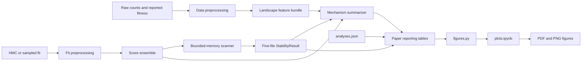

# Code guide

This guide explains how data move through the repository, which module owns each
calculation, and where to make common changes. It is written for someone who
wants to inspect or modify the analysis rather than only rerun it.

## Start with the mental model

The repository works with three nested objects:

1. A **landscape** is one experimental count table and its reported fitness
   values.
2. An **analysis run** is one landscape analyzed with one inference procedure,
   model specification, and fit artifact.
3. A **sample landscape** is one posterior draw, conditional predictive count
   draw, or bootstrap sample from that analysis run. It assigns one score to
   every variant and therefore induces one complete ranking.

An analysis run is identified by
[`AnalysisIdentity`](src/dms_fitness_stability/identity.py#L21):

```text
protein_family × landscape × inference_method × model_spec × fit_id
```

Its normalized `analysis_id` is used for result directories and table joins.
Several analysis runs can use the same landscape. Those runs share the same
experimental counts and should not be treated as independent experimental
replicates. The paper figures therefore nest model runs within landscapes.

The current paper score is `log_mean_growth`, with larger values ranked first.
Different native HMC variables are transformed to this common scale before any
ranking is performed.

## End-to-end map



The important boundary is the aligned logical array `sample × variant`. For
HMC, `sample` is a stacked chain/draw pair. For `mle_predictive`, it is one
count-derived score landscape drawn conditional on fixed optimized parameters.
It is not MLE estimator uncertainty or a resample-and-refit bootstrap.
For `hmc_count_based`, each sample is a count-derived score landscape computed
from the posterior-predictive counts paired with one HMC draw. It jointly
contains posterior parameter uncertainty and predictive count variation.

[`ScoreEnsemble`](src/dms_fitness_stability/score_ensembles.py) is the generic
persisted form of this boundary. Schema 2 stores direct-HMC posterior scores,
MLE predictive scores, and HMC count-based scores with full and analysis
variant axes. HMC-derived bundles preserve reversible chain/draw coordinates.
The loader also lazily normalizes external schema-1 proxy bundles, so all three
runners share `analyze_score_ensemble()`.

[`LandscapeFeatureBundle`](src/dms_fitness_stability/landscape_features.py)
stores the exact terminal observed-count features used by mechanism figures.
Raw counts remain in `examples/paper/data_preprocessing`; fit-dependent score
production remains in `examples/paper/fit_preprocessing`. Normal downstream
analysis consumes neither source.

## Suggested reading order

A useful first pass through the code is:

1. [`identity.py`](src/dms_fitness_stability/identity.py#L21) for run identity.
2. [`hmc_scanning.py`](src/dms_fitness_stability/hmc_scanning.py) for the
   landscape-independent bounded-memory scan and result-table construction.
3. [`streaming.py`](src/dms_fitness_stability/streaming.py#L8) for the lower-level
   top-K and exact-rank primitives.
4. The generic subset/multi-score test in
   [`test_hmc_scanning.py`](tests/test_hmc_scanning.py), followed by the dense
   PDZ oracle in
   [`test_full_pdz_hmc_scan_matches_dense_scores_and_ranks()`](tests/test_pdz_adapter.py#L263).
5. One adapter score reader, such as
   [`scan_nuclease_hmc()`](src/dms_fitness_stability/adapters/nuclease.py).
6. [`StabilityResult`](src/dms_fitness_stability/results.py#L14) for persistence.
7. [`build_paper_tables()`](src/dms_fitness_stability/reporting.py#L345) for
   paper statistics.
8. [`figures.py`](examples/paper/figures.py#L192) for panel composition.
9. [`plots.ipynb`](examples/paper/plots.ipynb) last. The notebook intentionally
   contains little logic.

The tests are often easier to understand than the large adapters because they
compare streamed output with dense arrays whose correct ranks are visible by
inspection.

## Repository ownership

### Identity and generic sample loading

[`AnalysisIdentity`](src/dms_fitness_stability/identity.py#L21) owns run-level
identity. Keep these fields separate:

- `landscape`: the experimental data;
- `inference_method`: HMC, MLE bootstrap, or another uncertainty procedure;
- `model_spec`: prior family, growth curve, or other model assumptions; and
- `fit_id`: the specific artifact or job.

[`load_fit()`](src/dms_fitness_stability/fits.py#L16) opens SciStanPy HMC or MLE
objects. [`extract_score_samples()`](src/dms_fitness_stability/fits.py#L32)
normalizes either `chain × draw × variant` or `sample × variant` data to an
xarray `sample × variant` score matrix.

[`analyze_stability()`](src/dms_fitness_stability/analysis.py#L30) is the small,
generic dense-array workflow used by the toy example. It creates ordinary top-K
summaries, but it does **not** currently produce the exact model-reference and
`model_tracked_rank` arrays required by paper reporting. A future MLE-bootstrap
adapter must either extend this function or add a dense score-ensemble builder
that writes the same schema as the HMC scanners.

### Input and landscape adapters

[`prepare_counts()`](src/dms_fitness_stability/inputs.py#L26) is the generic
count-table helper. It validates variant identity, pools counts, and chooses the
available reference fitness.

The domain adapters own biological file interpretation and HMC column alignment:

- PDZ trans loading:
  [`load_pdz_trans()`](src/dms_fitness_stability/adapters/pdz.py#L293)
- PDZ cis loading:
  [`load_pdz_cis()`](src/dms_fitness_stability/adapters/pdz.py#L366)
- CRIPT-N/CRIPT-C loading:
  [`load_pdz_cript()`](src/dms_fitness_stability/adapters/pdz.py#L464)
- TrpB loading:
  [`load_trpb_landscape()`](src/dms_fitness_stability/adapters/trpb.py#L82)

Every loader must return a variant table in the exact order expected by the fit.
The scanners use integer `variant_index` values as compact references into that
table. Reordering the table after alignment silently changes every downstream
identity, so loaders reject ambiguous or out-of-order inputs.

Adapters may also select native posterior variables, transform them onto a
common direction, compute score blocks, and verify embedded counts. They must
not reimplement top-K frontiers, tracked-rank accumulation, model-reference
selection, sample subsampling, or result-table construction. Those operations
belong to [`scan_hmc_scores()`](src/dms_fitness_stability/hmc_scanning.py) and
the primitives it calls.

The tests that best document these rules are:

- [PDZ cis alignment](tests/test_pdz_adapter.py#L97)
- [PDZ CRIPT sequence reconstruction](tests/test_pdz_adapter.py#L145)
- [TrpB reported-subset alignment](tests/test_trpb_adapter.py#L43)
- [TrpB out-of-order rejection](tests/test_trpb_adapter.py#L70)

### Score definitions

PDZ currently exposes the names in
[`PDZ_SCORE_NAMES`](src/dms_fitness_stability/adapters/pdz.py#L62):

- `log_mean_growth`: sampled latent assay score;
- `count_ratio`: posterior-predictive output/input ratio; and
- `dimsum_fitness`: a posterior-predictive DiMSum-style score normalized to wild
  type.

The native posterior target is selected by
[`_growth_target()`](src/dms_fitness_stability/adapters/pdz.py#L563), transformed
by [`_to_log_mean_growth()`](src/dms_fitness_stability/adapters/pdz.py#L573), and
read blockwise by [`_block_scores()`](src/dms_fitness_stability/adapters/pdz.py#L687).
Count-based proxies are calculated in
[`_count_proxies()`](src/dms_fitness_stability/adapters/pdz.py#L641). PDZ
count-based scores require the wild-type count block to be processed first.

TrpB exposes
[`TRPB_SCORE_NAMES`](src/dms_fitness_stability/adapters/trpb.py#L38). Its
[`_growth_target()`](src/dms_fitness_stability/adapters/trpb.py#L168) maps flat
and hierarchical fits onto `r`, `log_r_mean`, or `inv_r_mean`, and
[`_to_log_mean_growth()`](src/dms_fitness_stability/adapters/trpb.py#L183)
expresses all of them as log mean growth. Posterior-predictive ratios are handled
by [`_posterior_count_ratio()`](src/dms_fitness_stability/adapters/trpb.py#L198).

The paper workflow requests only `log_mean_growth`. This is the latent score
that matches the paper's definition of sampled ranks. Predictive count-ratio
rankings include the noise of a new sequencing realization and answer a
different question.

### Persisted count-derived score workflows

[`ScoreEnsemble`](src/dms_fitness_stability/score_ensembles.py) owns the common
`score_name × sample × variant` persistence contract. `mle_predictive` uses the
`conditional_repeated_experiment` uncertainty target; `hmc_count_based` uses
`posterior_predictive_count_landscape`. HMC-derived bundles also carry
`source_sample_id`, `source_chain`, and `source_draw` coordinates so the
flattened sample axis is reversible.

The family builders remain in their adapters:

- `build_pdz_hmc_count_score_ensemble()` reuses `_count_proxies()` and reads the
   wild-type counts before processing variant blocks;
- `build_trpb_hmc_count_score_ensemble()` makes one pass for per-draw stop means
   and maxima and a second pass for Johnston fitness; and
- `build_nuclease_hmc_count_score_ensemble()` processes sample blocks over the
   complete fitted variant universe because gate-frequency normalization is
   global.

The family builders write into temporary float32 memmaps and return schema-2
`ScoreEnsemble` objects. The preprocessing boundary publishes each bundle and
removes its temporary files.
[`preprocess_hmc_count_based.py`](examples/paper/preprocess_hmc_count_based.py)
owns artifact resolution, free-space checks, resumability, and staged
publication. Both [`run_hmc_count_based.py`](examples/paper/run_hmc_count_based.py)
and [`run_mle.py`](examples/paper/run_mle.py) call `analyze_score_ensemble()`.

## Why the scanner streams

Some PDZ fits contain more than 100,000 variants and tens of thousands of draws.
A dense sample-by-variant matrix can exceed convenient memory. The common HMC
engine reads native HDF5/NetCDF chunks and retains only the arrays needed later.

[`scan_hmc_scores()`](src/dms_fitness_stability/hmc_scanning.py) owns sample
subselection, candidate-to-HMC index mapping, the scan passes, xarray assembly,
and common result tables. A landscape adapter supplies aligned variants and a
callback that reads one score block. NucB uses this interface directly. The
older PDZ and TrpB scanner bodies implement the same passes and should be moved
onto this callback interface when they are next changed; their duplicated loops
are historical implementation debt, not landscape-specific methodology.

The reusable operations are in [`streaming.py`](src/dms_fitness_stability/streaming.py):

- [`empty_top_k()`](src/dms_fitness_stability/streaming.py#L32) initializes a
  per-sample frontier.
- [`merge_top_k()`](src/dms_fitness_stability/streaming.py#L42) merges one
  variant block into that exact frontier using `argpartition`, then sorts the
  retained scores.
- [`empty_tracked_ranks()`](src/dms_fitness_stability/streaming.py#L72)
  initializes average ranks at 0.5.
- [`accumulate_tracked_ranks()`](src/dms_fitness_stability/streaming.py#L79) adds
  the number of block scores above each tracked score plus half the number tied.
  After every block, this is the exact descending average rank.
- [`select_reference_top_k()`](src/dms_fitness_stability/streaming.py#L8) orders
  variants by median sampled score and breaks exact ties by `variant_index`.

The core algorithm is verified against dense SciPy ranks in
[`test_streamed_top_k_and_tracked_ranks_match_dense_calculation()`](tests/test_streaming.py#L13)
and tie behavior is verified in
[`test_reference_top_k_uses_sample_medians_and_deterministic_ties()`](tests/test_streaming.py#L52).

## The four HMC passes

The common engine, and the older PDZ/TrpB implementations it replaces, use the
same structure when `tracked_model_top_n > 0`:

1. **Reported-cohort values.** Read only blocks containing the reported top
   `tracked_top_n` and retain their sample scores.
2. **Full scan.** Visit every candidate. Update each sample's ordered top
   `retain_k`, add exact rank contributions for the reported cohort, and record
   every candidate's median score.
3. **Model-cohort values.** Select the median-score model-reference top
   `tracked_model_top_n`, then reread only the blocks containing those variants.
4. **Model-cohort ranks.** Visit every candidate again and accumulate exact
   full-landscape ranks for the fixed model cohort.

When model tracking is disabled, passes 3 and 4 are skipped. The extra passes do
not fit a new model; they reread an existing fit to retain exact ranks for a new
fixed cohort.

## The compact result schema

[`StabilityResult`](src/dms_fitness_stability/results.py#L14) saves five files:

```text
metadata.json   run identity, provenance, settings, warnings
variants.csv    one row per aligned candidate
stability.nc    sample-level selections, scores, and retained ranks
summary.csv     per-K inclusion and retained-cohort summaries
overlaps.csv    legacy sampled pair/reference overlap summaries
```

The current schema version is set by
[`RESULT_SCHEMA_VERSION`](src/dms_fitness_stability/analysis.py#L20). In a paper
result with one score, 16,000 samples, `retain_k=1000`,
`tracked_top_n=1000`, and `tracked_model_top_n=100`, `stability.nc` contains:

| Variable | Dimensions | Meaning |
| --- | --- | --- |
| `variant_index` | `score_name, sample, selection_rank` | Ordered sample top 1,000 |
| `score` | `score_name, sample, selection_rank` | Scores corresponding to that ordering |
| `tracked_score` | `score_name, sample, tracked_variant` | Scores for reported top 1,000 |
| `tracked_rank` | `score_name, sample, tracked_variant` | Exact full ranks for reported top 1,000 |
| `model_reference_variant_index` | `score_name, model_reference_rank` | Median-score reference top 1,000 |
| `model_reference_score` | `score_name, model_reference_rank` | Median scores for that reference |
| `model_tracked_variant_index` | `score_name, model_tracked_variant` | Model-reference top 100 indices |
| `model_tracked_score` | `score_name, sample, model_tracked_variant` | Sample scores for model top 100 |
| `model_tracked_rank` | `score_name, sample, model_tracked_variant` | Exact full ranks for model top 100 |

The paper summaries are recomputed from `stability.nc`; they do not depend on the
random-pair estimates in `overlaps.csv`.

## From compact results to paper tables

[`examples/paper/analyses.json`](examples/paper/analyses.json) is the ordered
manifest of analysis runs. [`load_manifest()`](examples/paper/summarize.py#L28)
validates its fields and duplicate IDs.
[`summarize_manifest()`](examples/paper/summarize.py#L65) requires one matching
result directory per manifest entry, verifies identity metadata, and calls
[`build_paper_tables()`](src/dms_fitness_stability/reporting.py#L345).

The six tables have distinct purposes:

| Table | Producer | Purpose |
| --- | --- | --- |
| `inventory.csv` | `_inventory()` | Run order, identity, sizes, artifact warnings |
| `rank_percentiles.csv` | [`_rank_percentiles()`](src/dms_fitness_stability/reporting.py#L146) | Reported-rank sample percentiles and ECDF values |
| `rank_agreement.csv` | [`_rank_agreement()`](src/dms_fitness_stability/reporting.py#L191) | Direct reported-versus-median-score rank displacement |
| `model_rank_intervals.csv` | [`_model_rank_intervals()`](src/dms_fitness_stability/reporting.py#L216) | Exact 5th/50th/95th ranks for model top K |
| `top_k_curves.csv` | [`_top_k_curves()`](src/dms_fitness_stability/reporting.py#L259) | Exact self-consistency and fixed-reference overlaps |
| `top_k_candidates.csv` | [`_top_k_candidates()`](src/dms_fitness_stability/reporting.py#L301) | Inclusion probabilities and candidate-set flags |

The exact self-consistency calculation is

$$
C_k = \frac{\sum_i c_i(k)[c_i(k)-1]}{S(S-1)k},
$$

where $c_i(k)$ is the number of samples whose top-$k$ contains variant $i$ and
$S$ is the number of samples. This counts all ordered pairs of distinct samples;
no random pair subsampling is needed.

## From tables to figures

[`load_tables()`](examples/paper/figures.py) reads the six core CSVs.
[`set_paper_style()`](examples/paper/figures.py#L91) owns global typography and
axis defaults. Core and mechanism composition functions include:

- [`figure_reported_order()`](examples/paper/figures.py#L192)
- [`figure_rank_uncertainty()`](examples/paper/figures.py#L495)
- [`figure_top_k_stability()`](examples/paper/figures.py#L758)
- [`figure_ranking_mechanisms()`](examples/paper/figures.py)
- [`figure_functionality_distributions()`](examples/paper/figures.py)
- [`figure_fitness_uncertainty_by_analysis()`](examples/paper/figures.py)

[`save_figure()`](examples/paper/figures.py#L1137) writes one vector PDF and one
300-dpi PNG. [`build_all_figures()`](examples/paper/figures.py#L1148) is the
script-friendly entry point.

The notebook setup cell chooses `MAIN_K` and `REPRESENTATIVE_IDS`, loads the
six tables, and calls these functions. Statistical calculations should stay in
`reporting.py`; reusable plotting logic should stay in `figures.py`; the
notebook should remain a short composition and inspection surface.

See [the paper workflow README](examples/paper/README.md#how-the-figures-are-made)
for the exact source table, formula, panel selection, and interpretation of every
current figure.

## Section 4 mechanism workflow

[`mechanisms.py`](src/dms_fitness_stability/mechanisms.py) owns the
inference-neutral features used to connect experimental support with score,
rank, and top-K uncertainty:

- `paired_replicate_features()` for paired PDZ input/output replicates;
- `grouped_output_disagreement()` for TrpB output replicates nested within
   timepoints while removing timepoint means;
- `scan_fixed_cohort()` for exact score/rank trajectories of arbitrary
   top-100 challengers without storing the full sample-by-variant matrix;
- `scan_proxy_fixed_cohort()` for the same calculation over persisted
   count-derived proxy draws, with finite-aware score and rank summaries;
- `score_uncertainty()` for raw and run-normalized sampled score intervals;
- `local_score_spacing()` and `count_within_score_window()` for crowding defined
   only from median scores; and
- `boundary_difficulty()` for uncertainty relative to local median-score
   spacing around rank 100, while retaining the rank-100/101 gap as a
   diagnostic.

[`summarize_mechanisms.py`](examples/paper/summarize_mechanisms.py) is the
manifest-driven entry point. Normal execution loads `ScoreEnsemble` and
`LandscapeFeatureBundle`, delegates fixed-cohort score/rank scanning to
[`mechanism_reporting.py`](src/dms_fitness_stability/mechanism_reporting.py),
and creates the eight paper-specific joinable tables. The cache is invalidated
if the source signature, score contract, candidate universe, or tracked cohort
changes. Direct fit/HDF5 scanning lives only under `fit_preprocessing` and is
available through the explicit migration-only `--fit-backed` option.

PDZ landscapes currently have three paired input/output replicates. TrpB A--C
have timepoints but one output observation per timepoint, so replicate
discordance is unavailable. TrpB D--I have two output replicates per timepoint
sharing one input library; their disagreement statistic removes each timepoint
mean before pooling residual heterogeneity. Timepoints are never called
replicates.

Figure 4 is composed by `figure_ranking_mechanisms()` in
[`examples/paper/figures.py`](examples/paper/figures.py). The notebook remains a
table-reading composition layer. Panels (a) and (b) show within-run decile
summaries for count support to score uncertainty and score uncertainty to rank
uncertainty. `_select_score_geometry_pair()` selects the deterministic
same-analysis, nearby-rank pair used in panels (c) and (d): focal score widths
must match within a factor of 1.2, and selection maximizes local-spacing contrast
without using rank-interval width. `_plot_score_geometry()` renders both
neighborhoods on one normalized score scale.

### Figure 4: exact quantities and data path

Figure 4 uses one score definition, `log_mean_growth`, with larger values always
meaning greater fitted fitness. The adapters convert positive-scale targets with
`log()` and inverse-scale targets with `-log()` before ranking. For one analysis
run, let $z_i^{(s)}$ denote the transformed score of variant $i$ in retained
posterior sample $s$. A run fixes the landscape, fit artifact, inference method,
model specification, and score definition. Quantities are never pooled across
runs before they are summarized within a run.

`scan_fixed_cohort()` produces two different kinds of rank that should not be
conflated:

1. The **sampled full-landscape rank** $R_i^{(s)}$ is obtained by sorting all
   candidates by $z_i^{(s)}$ in posterior sample $s$. Ranking is descending and
   exact ties receive their average rank.
2. The **median-score reference rank** $r_i^\star$ is fixed once per run. First
   calculate the posterior-median score
   $m_i=Q_{0.50}(z_i^{(s)})$ for every candidate, then sort $m_i$ in descending
   order. Exact median-score ties are resolved by stable candidate index. In
   general, $r_i^\star$ is not equal to $Q_{0.50}(R_i^{(s)})$ because ranking
   and taking a median do not commute.

The primary Figure 4 cohort is conditional on the top-100 decision. In every
run it contains the 100 variants with $r_i^\star\leq100$ plus every outside
variant with posterior top-100 inclusion probability at least 0.01. The current
tables contain 16,047 such run--variant rows: from 112 to 2,286 rows per run.
The same biological variant can therefore contribute once for each model fit to
its landscape. Thin curves are run summaries; they are not independent
biological replicates.

#### Score interval, rank interval, and score IQR

Three distinct quantities appear in the figure:

1. The **90% posterior score interval** for one variant is
   $[Q_{0.05}(z_i),Q_{0.95}(z_i)]$. Its raw width is
   $W_i^z=Q_{0.95}(z_i)-Q_{0.05}(z_i)$. This is a within-variant summary across
   posterior samples.
2. The **90% posterior rank interval** is
   $[Q_{0.05}(R_i),Q_{0.95}(R_i)]$. Its width is
   $W_i^R=Q_{0.95}(R_i)-Q_{0.05}(R_i)$ rank positions. It uses the same
   posterior samples, but each sample rank is calculated against the entire
   candidate landscape.
3. The **run score IQR** is a scale ruler, not another uncertainty interval.
   Let $m_{(1)},\ldots,m_{(1000)}$ be the posterior-median scores of the first
   1,000 variants in the median-score reference ordering. Then
   $S_{\mathrm{run}}=Q_{0.75}(m_{(1:1000)})-Q_{0.25}(m_{(1:1000)})$. It is a
   cross-variant spread of 1,000 point summaries within one run.

The plotted relative score uncertainty is

$$
U_i = \frac{W_i^z}{S_{\mathrm{run}}}.
$$

Thus $U_i=1$ means that one variant's central 90% posterior score interval is as
wide as the middle 50% spread of posterior-median scores among that run's top
1,000 candidates. It does not mean 100% posterior uncertainty, and
$S_{\mathrm{run}}$ is not the posterior IQR of variant $i$. The normalization is
needed because score scales differ across model specifications. Within a run it
is a single positive constant: it does not change the ordering of score widths,
panel (b)'s decile assignments, or the matched comparison in panels (c)--(d).
It does affect absolute cross-run vertical placement in panel (a), which is why
the raw width and alternative crowding scales remain in `mechanism_variants.csv`
for sensitivity analyses.

The relevant generated columns are:

| Meaning | `mechanism_variants.csv` column |
|---|---|
| $Q_{0.05}(z_i)$, $Q_{0.50}(z_i)$, $Q_{0.95}(z_i)$ | `score_lower`, `score_median`, `score_upper` |
| $W_i^z$ | `score_interval_width` |
| $S_{\mathrm{run}}$ | `reference_score_iqr` |
| $U_i=W_i^z/S_{\mathrm{run}}$ | `normalized_score_interval_width` |
| $Q_{0.05}(R_i)$, $Q_{0.50}(R_i)$, $Q_{0.95}(R_i)$ | `rank_lower`, `rank_median`, `rank_upper` |
| $W_i^R$ | `rank_interval_width` |
| fixed $r_i^\star$ | `model_reference_rank` |

#### Panel (a): input support to score uncertainty

The input-support value is
$x_i=\log(1+n_i^{\mathrm{input}})$. PDZ input counts are summed across its three
paired input libraries; TrpB uses the shared starting-library count for that
variant. Input counts are used because they are measured before selection and
are less directly determined by variant fitness than output counts.

For each analysis run separately, `_quantile_bin()` orders the primary cohort by
$x_i$ and assigns approximately equal-sized deciles. Decile 1 has the lowest
input counts and decile 10 the highest. Because `log1p()` is monotone, it does
not change decile membership relative to raw input counts. Equal count ties can
be split between adjacent bins using stable row order. The x-axis is an ordinal
within-run decile, not a common read-count scale: decile 10 can correspond to
different absolute counts in different runs.

For each run and decile, `_run_decile_summary()` plots the median $U_i$. The
line merely joins ten bin medians; it is not a fitted regression. The y-axis is
logarithmic but tick values remain values of $U_i$. A downward line means that
better represented input variants tend to have narrower posterior score
intervals relative to the run's score scale.

Each faint line is one analysis run. To construct a bold family line,
`_plot_run_deciles()` first takes the median bin response across model runs for
each landscape, then takes the median across landscapes within PDZ or TrpB.
This prevents landscapes with more fitted models or larger challenger cohorts
from receiving more weight. No confidence band is plotted. In the current
tables, the bold decile-1 to decile-10 medians change from 2.22 to 1.15 for PDZ
and from 6.17 to 1.82 for TrpB.

#### Panel (b): score uncertainty to rank uncertainty

Panel (b) repeats exactly the same binning and aggregation procedure, but orders
variants within each run by $U_i$. Decile 1 contains the narrowest relative
score intervals and decile 10 the widest. For each bin, the response is the
median $W_i^R$ in rank positions. The y-axis is logarithmic. A value of 100
means that the central 90% of the variants' sampled ranks spans 100 rank
positions; it is not a score quantity and is not divided by the score IQR.

The panel asks whether uncertainty in the latent score propagates into
uncertainty in ordering. It is a marginal descriptive relationship: it does not
hold reference rank, local score spacing, or model specification fixed. Score
and rank intervals also come from the same posterior draws, so the panel is not
an independent validation or a causal test. In the current family summaries,
the median rank width rises from 180 to 1,418 positions across PDZ deciles and
from 942 to 5,805 across TrpB deciles.

#### Panels (c) and (d): matched score geometry

These panels explain why $U_i$ alone cannot determine $W_i^R$. Local median-score
spacing at reference rank $r$ is

$$
D_r = \frac{m_{(r-5)}-m_{(r+5)}}{10S_{\mathrm{run}}}.
$$

It is the average posterior-median score drop per rank across ten rank steps,
expressed in run-IQR units per rank. Small $D_r$ means neighboring variants have
nearly identical posterior-median scores. It is computed from medians only and
does not use the focal variant's posterior width.

`_select_score_geometry_pair()` searches all model-reference top-100 variants
with focal ranks 10--95. An eligible pair must come from the same analysis run,
be at most 15 reference ranks apart, have complete five-rank neighborhoods on
both sides, and have score-width ratio at most 1.2. Among eligible pairs, it
maximizes the ratio of larger to smaller $D_r$. Ties favor closer score widths,
then closer reference ranks, then stable analysis/rank order. Crucially, pair
selection does not inspect $W_i^R$ or top-100 inclusion probability.

The current pair comes from TrpB libB under the Exponential--Sigmoid fit:

| Focal summary | More-separated panel (c) | Crowded panel (d) |
|---|---:|---:|
| median-score reference rank $r_i^\star$ | 10 | 23 |
| raw score $Q_{0.05},Q_{0.50},Q_{0.95}$ | -0.620, -0.426, -0.266 | -0.742, -0.555, -0.396 |
| raw score width $W_i^z$ | 0.354 | 0.346 |
| run score IQR $S_{\mathrm{run}}$ | 0.244 | 0.244 |
| relative score uncertainty $U_i$ | 1.449 | 1.418 |
| local spacing $D_r$ | 0.317 | 0.014 |
| sampled-rank $Q_{0.05},Q_{0.50},Q_{0.95}$ | 8, 16, 66 | 13, 40, 155 |
| rank width $W_i^R$ | 58 | 142 |

Panel (c) displays reference ranks 5--15; panel (d) displays ranks 18--28. The
y-axis is the fixed median-score reference rank, with better ranks at the top.
For every displayed variant, the point is $m_j$ and the horizontal segment is
$[Q_{0.05}(z_j),Q_{0.95}(z_j)]$. The highlighted diamond/segment is the focal
variant. The horizontal coordinate is centered and scaled separately for each
focal variant,

$$
X_j = \frac{z_j-m_{\mathrm{focal}}}{S_{\mathrm{run}}},
$$

so the dotted zero line is the focal posterior-median score. Both panels use the
same x-axis limits and, because they come from one run, the same denominator.
Absolute score levels are intentionally removed; the visual comparison is the
separation of neighboring medians relative to similarly wide intervals.

The horizontal intervals are marginal posterior intervals. Their overlap is an
illustration, not the calculation of rank uncertainty: posterior scores can be
correlated, and candidates outside the 11 displayed rows also affect rank.
The annotated $W_i^R$ is calculated from joint sample-by-sample full-landscape
ranks and therefore includes both effects. Panel (c) is only
"more-separated," not fully resolved; its rank interval still spans 58
positions. Panels (c)--(d) do not depict the rank-100 cutoff.

### Figures 8--10: landscape geometry and decision-relative uncertainty

`summarize_mechanisms.py` exports `functionality_scores.csv.gz` from each
validated mechanism cache. It contains one row per fitted candidate and
analysis with `score_median` and `model_reference_rank`.
`figure_functionality_distributions()` uses all of these rows for Figure 8's
Scott-bandwidth Gaussian KDEs. It does not use only the tracked mechanism
cohort. Each panel is one landscape, model analyses are overlaid, and the
vertical lines are their fixed rank-100 median scores. Score and density limits
are shared within protein family.

Figure 9 returns to the primary decision cohort in `mechanism_variants.csv`:
the fixed top 100 plus outside candidates with `top_100_inclusion_probability`
at least 0.01. `_decision_relative_score_frame()` validates and constructs

$$
X_i = \frac{\texttt{score\_margin\_to\_rank\_100}}
{\texttt{reference\_score\_iqr}},
\qquad
U_i = \texttt{normalized\_score\_interval\_width}.
$$

The first numerator is `score_median` minus the run's fixed rank-100 score. The
second quantity is the central 90% posterior score width divided by the same
top-1,000 median-score IQR. `figure_fitness_uncertainty_by_analysis()` renders
one panel per analysis, uses a log y-axis shared within protein family, marks
$X_i=0$, distinguishes top-100 members from outside challengers, and annotates
the within-run Spearman correlation. Panel-specific x-limits preserve broad
challenger clouds; all x values remain in the same normalized units.

These figures separate two objects that must not be conflated. Figure 8 shows
the distribution of cross-variant posterior medians. Figure 9 shows marginal
within-variant posterior score width along a decision-centered median-score
axis. Neither alone determines sampled rank uncertainty, which also depends on
local score spacing, candidates outside the displayed cohort, and joint
posterior correlation.

Figure 10 composes the existing per-run quantities into a four-column summary.
`_summary_why_frame()` starts from `_decision_relative_score_frame()`, validates
`mechanism_input_count`, `mechanism_output_count`, and
`top_100_inclusion_probability`, preserves zero counts with `log10(count + 1)`,
and joins run-level `sample_self_consistency`, `top_k_instability`, and
`challenger_count_q_ge_001`. `figure_summary_why_by_analysis()` renders one row
per analysis:

1. input log count versus `normalized_score_interval_width`;
2. output log count versus the same score uncertainty;
3. `decision_relative_fitness` versus score uncertainty; and
4. `decision_relative_fitness` versus `top_100_inclusion_probability`.

Input and output are separate panels because output abundance is partly a
consequence of fitness. Their trend lines are separate least-squares fits in
log-count/log-uncertainty coordinates; no confidence band is shown. The first
three panels share the family-level uncertainty ruler, while the last two share
one decision-margin range within each row. Filled points are fixed top-100
members and open points are outside challengers. Row annotations come from
`mechanism_runs.csv` and report top-100 instability and challenger count.

Figure 10 is a composition of dependent summaries, not a new causal model.
Variants share posterior draws, model runs of one landscape share counts, and
the output-count relationship is confounded by fitness. The figure should be
described as a compact descriptive explanation of the fitted instability.

#### What Figure 4 can and cannot establish

The intended chain is: input support is associated with score precision;
posterior score uncertainty is associated with rank uncertainty; and local
score geometry explains why similar score widths can have different rank
consequences. This is a proximate, model-conditional explanation. Panel (a) is
observational, panels (b)--(d) reuse related posterior quantities, and multiple
fits of one landscape share data. The figure does not estimate what would
happen after adding reads, changing replication, or changing the fitted model.
Those intervention-level questions require thinned or altered count data and a
new fit.

Controlled read downsampling is intentionally absent. It requires new inference
from thinned counts; changing raw counts beside an existing posterior would not
change latent-score uncertainty. See
[`FIT_PROVENANCE.md`](examples/paper/FIT_PROVENANCE.md) for the recovery gate.

## Common modifications

### Add another fit or model for an existing landscape

If the adapter already understands its variables and score transform:

1. Add the fit to [`examples/pdz/fit_jobs.json`](examples/pdz/fit_jobs.json) or
   [`examples/trpb/fit_jobs.json`](examples/trpb/fit_jobs.json).
2. Validate the artifact and run only that landscape/model through the relevant
   runner. PDZ starts at [`main()`](examples/pdz/run.py#L125); TrpB starts at
   [`main()`](examples/trpb/run.py#L78).
3. Use `--output-layout analysis-id --tracked-model-top-n 100` for a paper
   bundle.
4. Add the matching identity to
   [`examples/paper/analyses.json`](examples/paper/analyses.json).
5. Rerun `uv run python examples/paper/summarize.py`, then execute the paper
   notebook.

Do not reuse a `fit_id`. Manifest validation treats duplicate `analysis_id`
values as an error.

### Add a new landscape

A genuinely new source usually needs:

1. a landscape dataclass or reuse of an existing one;
2. a loader that builds aligned variants, counts, and reported fitness;
3. provenance and fit-manifest entries;
4. a scanner call using an existing score extraction path; and
5. synthetic alignment plus dense-rank tests.

Keep domain-specific parsing in `adapters/`. Do not put file-format assumptions
in `reporting.py` or `figures.py`.

### Change the main K

There are three separate limits:

- `top_k` controls which K values are summarized during scanning;
- `retain_k` controls how much of every sample ordering and model reference is
  retained; and
- `tracked_model_top_n` controls how many model-prioritized variants have exact
  full rank trajectories.

For the current paper bundles these values are 1,000, 1,000, and 100 in the
relevant dimensions. Changing `MAIN_K` to a value at most 100 only requires
rerunning `summarize.py` with `--main-k` and updating the notebook. A value above
100 requires rescanning with `--tracked-model-top-n` at least that large. Any
requested dense curve K must also be no larger than `retain_k`.

The invariant is enforced by
[`_require_paper_result()`](src/dms_fitness_stability/reporting.py#L51).

### Change the example runs

Edit only `REPRESENTATIVE_IDS` in the setup cell of
[`examples/paper/plots.ipynb`](examples/paper/plots.ipynb). Use IDs from
`inventory.csv`. This changes detailed example panels but not cross-run
summaries.

### Add or change a score

1. Add the public score name to `PDZ_SCORE_NAMES` or `TRPB_SCORE_NAMES`.
2. Compute one `sample × block_variant` array in the adapter's `_block_scores()`.
3. Decide and document whether larger values are better.
4. Add a dense synthetic test that verifies score values, top-K selections, and
   exact ranks.
5. Run the scanner with `--score <name>` and build a separate result bundle or
   table set.

Do not describe posterior-predictive count-ratio ranks as latent fitness
uncertainty. They include a new layer of simulated count noise.

### Add a paper statistic

If the statistic can be derived from retained arrays:

1. add a private producer in
   [`reporting.py`](src/dms_fitness_stability/reporting.py);
2. add its columns to an existing table, or add a new table name to
   `PAPER_TABLE_NAMES`;
3. update `summarize.py` and `load_tables()` if a new table is added;
4. add a hand-checkable synthetic formula test in
   [`tests/test_reporting.py`](tests/test_reporting.py#L138); and
5. add plotting only after the table is verified.

If the needed draw-level quantity is not retained in `stability.nc`, the scanner
schema must change and the large fits must be reread.

### Change figure appearance or panel selection

Edit [`examples/paper/figures.py`](examples/paper/figures.py), not generated PNGs
or CSVs. Shared colors and marker encodings are defined at the top of that file.
Panel-specific logic is in:

- [`_rank_interval_panel()`](examples/paper/figures.py#L391)
- [`_candidate_panel()`](examples/paper/figures.py#L605)
- [`_stability_curve_panel()`](examples/paper/figures.py#L685)

Run the synthetic render test
[`test_paper_figures_render_and_save_from_tidy_tables()`](tests/test_reporting.py#L183)
before executing the real notebook.

### Add MLE-bootstrap results

The existing useful pieces are:

- `AnalysisIdentity(inference_method="mle_bootstrap", ...)`;
- `extract_score_samples()`, which accepts a native `sample` dimension; and
- inference-neutral calculations in `streaming.py`, `reporting.py`, and
  `figures.py`.

What is still missing is a concrete adapter from the actual bootstrap file
schema to the full paper `stability.nc` schema. Implement that adapter only after
inspecting the real files. It must preserve variant alignment, construct the
median-score model reference, and retain exact model-cohort ranks. Do not label
`mle_bootstrap` as a `model_spec`; it is an `inference_method`.

## Important distinctions and pitfalls

### Rank of median score is not median rank

The model reference ranks each variant's median sampled score. Figure 2 also
shows each variant's median sampled rank. These operations need not agree
because ranking and taking medians do not commute.

### Reported and model cohorts answer different questions

- `tracked_variant_index` is the fixed reported top 1,000 used for the
  reported-rank percentile diagnostic.
- `model_tracked_variant_index` is the fixed median-score model top 100 used for
  exact model-centered rank intervals.

A variant can belong to either or both cohorts. The adapters merge summaries in
[`_combined_tracked_summary()`](src/dms_fitness_stability/adapters/pdz.py#L822)
and retain explicit Boolean flags.

### ECDF-to-uniform area is not rank error

The reported-rank percentile ECDF is descriptive. Area zero means the reported
ranks occupy a uniform range of sampled percentiles. Exact rank recovery gives
area 0.25 because all percentiles equal 0.5. Do not sort analyses by this value
and call smaller values better agreement.

### Several models on one landscape are not independent experiments

The same counts can be analyzed under several priors or growth curves. The
family stability panels first take a median across runs within each landscape,
then a median across landscapes. Preserve that hierarchy when adding aggregate
statistics.

### Sample counts can differ

Most current runs have 16,000 HMC samples; at least one has 24,000. Inclusion
probabilities remain comparable, but finite Monte Carlo precision differs.
`inventory.csv` records `n_samples` so this remains visible.

### Limited artifacts remain visible

TrpB jobs with missing embedded observed data or reader fallbacks are marked in
`metadata.json` and `inventory.csv`. Do not erase warnings to make a plot cleaner.
PDZ currently uses `artifact_status="unrecorded"` where compact metadata does
not contain enough diagnostic evidence to claim validation.

### Generated files are disposable

The source of truth is code, manifests, raw data, and fit artifacts. These are
generated and ignored by Git:

- `/data/data_dms_stability/paper/results/`
- `/data/data_dms_stability/paper/analysis_data/scores/mle_predictive/canonical/`
- `/data/data_dms_stability/paper/analysis_data/scores/hmc_count_based/canonical/`
- `/data/data_dms_stability/paper/mle_predictive/results/`
- `/data/data_dms_stability/paper/mle_predictive/mechanisms/cache/`
- `examples/paper/output/tables/`
- `examples/paper/output/figures/`
- `examples/paper/output/mle_predictive/`

Do not manually edit generated CSVs or figures. Change the producer and rerun.

## Validation workflow

For a local algorithm change, start narrow:

```bash
uv run pytest tests/test_streaming.py tests/test_reporting.py -q
```

For adapter changes:

```bash
uv run pytest tests/test_pdz_adapter.py tests/test_trpb_adapter.py -q
```

For figure changes:

```bash
uv run pytest tests/test_reporting.py -q
uv run python examples/paper/summarize.py
uv run --with jupyter jupyter nbconvert \
  --execute --to notebook --inplace examples/paper/plots.ipynb \
  --ExecutePreprocessor.timeout=600
```

For the complete MLE-predictive path:

```bash
uv run python examples/paper/preflight_mle.py
uv run python examples/paper/preprocess_mle.py
uv run python examples/paper/run_mle.py
uv run python examples/paper/audit_mle.py
uv run python examples/paper/validate_mechanisms.py \
   --manifest examples/paper/analyses_mle.json \
   --table-dir examples/paper/output/mle_predictive/tables
uv run jupyter nbconvert --execute --to notebook --inplace \
   examples/paper/plots_mle.ipynb
```

Before considering a change complete:

```bash
uv run pytest -q
uv run ruff check .
```

When a scanner schema changes, use a small real-data smoke run with reduced
`--n-samples`, `--retain-k`, and cohort sizes before rereading every full fit.
The synthetic dense-rank tests establish correctness; the smoke run establishes
compatibility with the actual HDF5/NetCDF layout.
